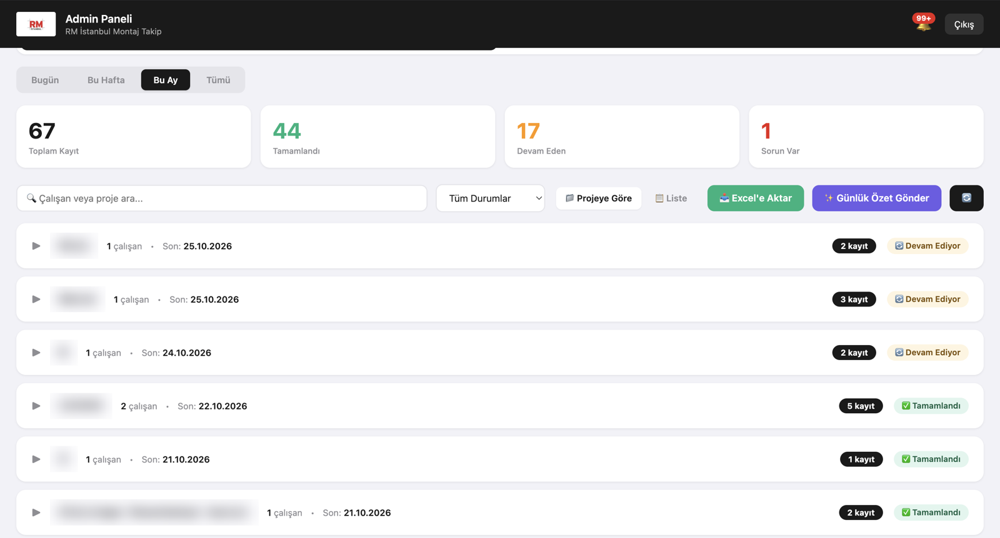

# Hi, I'm Tardu

I build LLM-agent systems and production data apps with Claude API, MCP, FastAPI and React.

Math & Physics BSc from the University of Toronto, now doing an MSc in Data Science & Analytics at Toronto Metropolitan University. Long term I'm most interested in health, wearables and physiological data.

Open to AI engineering roles: part-time now, internship or co-op from May 2027.

## Projects

**[Jarvis](https://tarduak-cs.github.io/jarvis-showcase/): multi-agent personal assistant**\
School, career, email and YouTube agents write to a shared database behind a FastAPI dashboard, with a read-only MCP server so Claude Desktop can query it. A model router sends each task to a fast, mid or large Claude model, retries invalid output on the next tier, and logs the cost of every call. Extracted data is only accepted if the quoted text appears verbatim in the source PDF. 560+ automated tests.\
`Python` `FastAPI` `SQLAlchemy` `React/TypeScript` `Claude API` `MCP`

**RM İstanbul Field Operations Platform**\
Gives managers a live view of 5 field installation teams. Workers log job status, photos and GPS location from their phones, and an AI assistant emails managers a daily summary in Turkish. Built and launched solo. (The app is login-only, so here's the admin dashboard with client job names blurred.)\
`Supabase` `PostgreSQL` `Netlify` `Claude API`

**[Credit Card Churn Prediction](https://tarduak-bank-churn.streamlit.app)**\
Set the flagging cutoff from the cost of a retention offer vs. the value of a saved customer, catching 98% of leavers and raising expected profit by ~$3K on held-out data. SHAP shows churn is driven by falling card activity, not demographics.\
`PostgreSQL` `XGBoost` `SHAP` `FastAPI` `Streamlit`

**[LifeOS](https://lifeos-tardu.vercel.app): personal health & biometrics platform**\
Combines sleep, HRV, resting heart rate, mood and workout data (including WHOOP and Oura imports) and finds links between daily habits and health trends.\
`React` `TypeScript` `Supabase` `Recharts`

## Stack

**AI & LLM:** Claude API / Anthropic SDK, LLM agents & tool use, MCP, output validation, model routing\
**Engineering:** FastAPI, SQLAlchemy, PostgreSQL, Supabase, React/TypeScript, pytest, Playwright\
**Data & ML:** Python, SQL, R, pandas, scikit-learn, XGBoost, SHAP

## Contact

[LinkedIn](https://linkedin.com/in/remzitarduakinci) · akincitardu1@icloud.com
